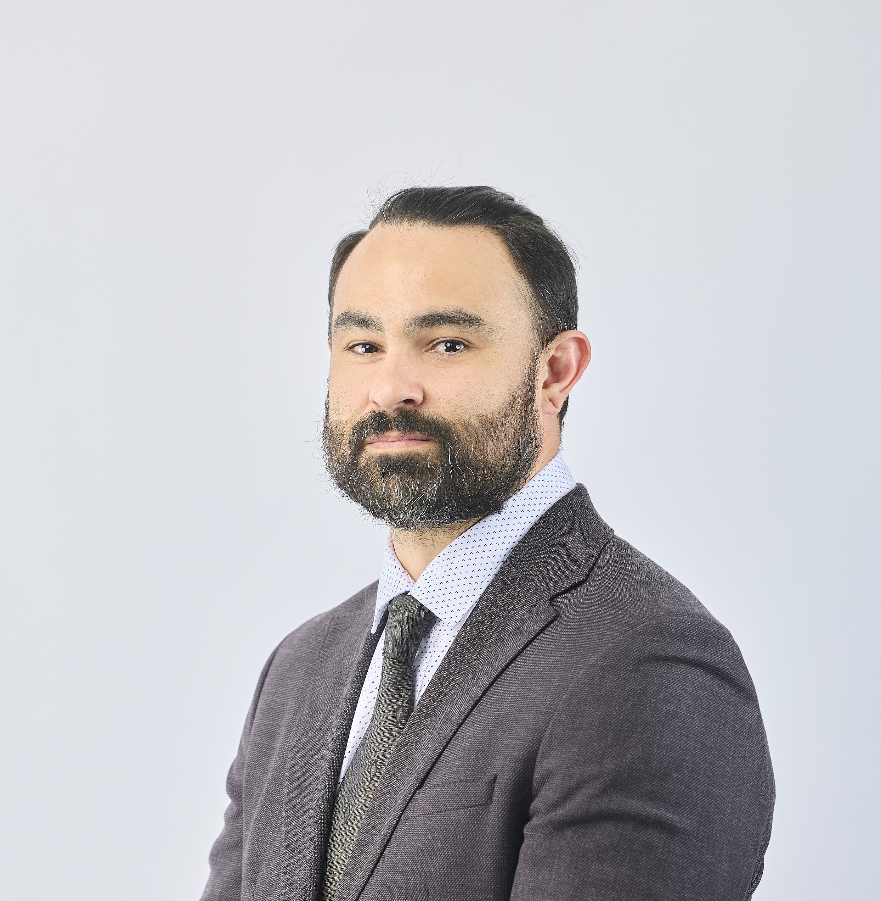

```{r echo = FALSE, out.width = "300px"}

```

I am an Associate Professor in the English Program for Global Mobility at [the University of Nagano](https://www.u-nagano.ac.jp/academics/teacher/gm/diaz/) and a Ph.D. candidate in the [Department of Linguistics](https://linguistics.ucdavis.edu/) at [UC Davis](https://www.ucdavis.edu/) working with Dr. [Santiago Barreda](https://www.santiagobarreda.com). \

I hold a Master of Arts in Linguistics from UC Davis, a Bachelor of Arts in Japanese, and a Master of Science in Education (TESOL) both from California State University, Fullerton. In addition to these academic degrees, I have over 12 years of language teaching experience both in the U.S. and abroad in Japan. 


